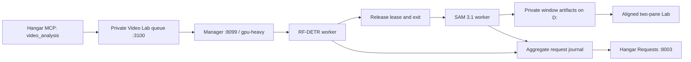

# Local video analysis through Hangar

`video_analysis` is a stdio MCP tool in `scripts/mcp-betenshi.mjs`. Read actions
are `list`, `status`, and `report`. `create` takes an explicit registered local
source, offset, bounded duration, cadence, and engine list. `cancel` and `retry`
address an existing job. It calls the private Lab API rather than running another
model server. Models execute sequentially, and the Lab's localhost/development
access checks still apply. `FOOTBALL_LAB_URL` accepts loopback HTTP only.

The worker obtains a shared lease before loading the model. Footprints for
`football-video-rfdetr` and `football-video-sam31` are separate from the console's
image SAM service; their conservative admission allowances and measurement basis
are in `config/model-meta.json`. Both use `gpu-heavy`. CUDA allocation remains
capped at 75%. Missing manager or denied admission fails closed before inference.

New manager code advertises renewable leases at `/resources` and supports
`POST /resources/leases/:id/renew`, with owner matching and an expiry check. The
worker renews every 30 seconds with a two-minute TTL. A lost heartbeat stops
processing at the next progress/window boundary and releases its own guards.
On the older running manager, it uses a bounded six-hour lease and releases it
in `finally`; it does not pretend renewal is available. Crash expiry is therefore
slower on that version. Activating manager renewal and the new GPU-service-load
guard requires a manager restart; the automated restart was blocked by approval
policy during implementation. No service was stopped to bypass that rejection.

The currently running model can be attached with
`python -m fai_video.hangar --observe <run>` only when its matching existing GPU
claim is present. `football-video-observe` reserves the shared slot with zero
**additional** modeled allocation: the worker was already loaded, and live free
VRAM still includes it. This is an observation bridge, not fresh inference
admission. Future jobs use their measured-profile workloads before model loading.

`X-Source: hangar-mcp` becomes a bounded job attribution value and the worker
reports `football-ai-lab/hangar-mcp` as caller. Start/heartbeat/completion events
share an attempt ID. Native partial output uses HTTP-style status 206; interruption
is separate from a successful result. Only aggregate counts, model names, status,
and a local Lab link reach Requests. No footage, source URL, masks, player rows,
or prompts are sent.

Each private run retains `hangar-events.jsonl` and a compact
`hangar-requests.json` latest-state snapshot. Requests rehydrates those records
after console restart, with bounded reads and duplicate heartbeat folding.
`FOOTBALL_VIDEO_LAB_ROOT` can point at another explicitly authorized local artifact
root. The default is the sibling `football-ai-lab/data/video_lab` directory.
Earlier completed states remain available even after a long heartbeat journal;
a delayed pending event cannot reopen a terminal request.

The model comparison uses original timestamps and exact prepared images for
review. Six-second identity resets, failed windows, and provisional visual
references are explicit; request completion does not establish detection or
tracking accuracy. Source artifacts stay in the private Lab rather than the
console's public gallery.

Verification includes MCP discovery/status/report, manager rejection of a
competing workload, durable trace recovery, privacy filtering, lease cleanup,
expiry/owner checks, and the existing console suite. Build into
`HANGAR_BUILD_DIR=var/video-build` to avoid replacing a live preview cache.
