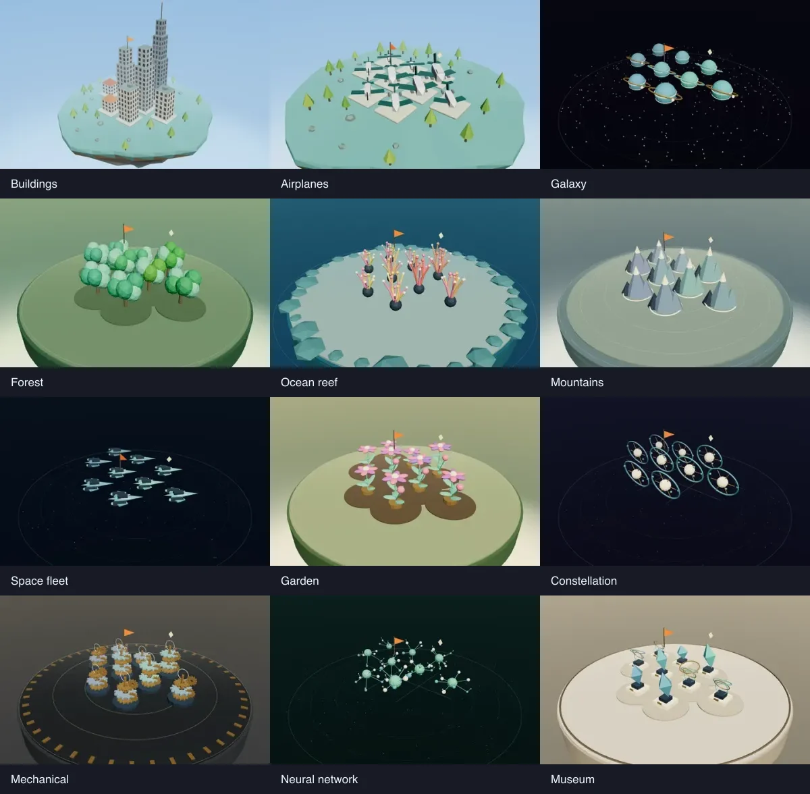

# Spatial views of your projects

Open **World**, then the view button beside **Size**. Choose a preview to switch
immediately. The chooser closes on selection; there is no second confirmation
or “Explore” action. Escape dismisses the chooser and returns focus to its button.
The colour-theme menu also offers a compact view selector.



| View | Spatial interpretation |
| --- | --- |
| Buildings | Original city on floating islands |
| Airplanes | A continuous airport apron with a central runway, taxiways, terminal piers, opposing gate rows, glazing and boarding bridges |
| Galaxy | Planets distributed across a galactic star field with three spiral dust arms |
| Forest | Irregular groves on a rolling, continuous landscape |
| Ocean reef | Branching coral on an uninterrupted sea floor, with suspended-particle scenery and caustic-like light ribbons |
| Mountains | Peaks distributed across a shared mountain landscape |
| Space fleet | Convoys in wedge-shaped squadron formations through open space |
| Garden | Flowering trails in a continuous garden |
| Constellation | Luminous stars in three dimensions, connected into category constellations |
| Mechanical | Staggered clockwork assemblies across a shared workshop grid |
| Neural network | A deterministic force-directed spatial graph; category links and observed shared repository topics bring related projects together |
| Museum | Sculptures in architectural galleries with walls, shared floors and open fronts |

Only Buildings retains islands, plots, decorative waterfalls, bobbing platforms,
and Hangar's architectural portals. Other views have their own positions, terrain
or open-space composition, camera framing, and navigation. Space views use drag
to orbit; ground views use drag to pan. Scrolling zooms in both. Category labels
remain useful grouping cues without fencing each group into an island.

The underlying catalog and organization never change when switching views.
Selection, search, filters, activity layers and arrival replay carry over. Each
view has deterministic positions, including seats for hidden projects, so hiding
and restoring a project does not shuffle its neighbors. Changing a view reframes
the camera to fit that view. Selecting a project still brings up its actual work,
sessions, running apps and repository tools.

In constellations and networks, hovering or selecting a project emphasizes its
connected edges. Nearby project names appear at readable zoom levels; names
are culled to avoid overlap. Constellation lines mean **shared category**. Neural
links mean **shared category** or an **observed shared repository topic**, with a
separate colour for topic links. These lines do not claim runtime communication,
dependencies or concurrent agent work. Without topic metadata, no topic links
are invented.

Size and complexity use the existing **Commits / MB** switch. These represent
observed repository facts, not completion, approval, quality or business value.
A project without an observed commit count retains the repository-size fallback.
Activity, attention, local availability, website addresses, actual coding jobs
and app ports retain their existing meanings. Physical pull-request flags remain
in the city view; attention badges remain available in every view.

The preference is saved per browser in `bt-world-style`. The standalone viewer
has the same options and accepts `?style=airplanes` (or another registered ID).
Unknown saved values fall back to Buildings. Geometry is procedural and local;
small parts are batched by material, replaced resources are disposed, and star
halos share one texture. Reduced motion and lighter graphics are respected.

## Local verification

No hosted workflows are needed:

```sh
npm run test:world
npx tsc --noEmit
python3 engine/selftest.py
HANGAR_BUILD_DIR=var/world-build npm run build
HANGAR_BUILD_DIR=var/world-build npx next start -H 127.0.0.1 -p 8017
```

In another terminal, point at installed Playwright Core and Chrome/Chromium if
not discoverable, then run the browser checks:

```sh
export PLAYWRIGHT_CORE=/absolute/path/to/playwright-core/index.mjs
export CHROMIUM=/absolute/path/to/chrome
HANGAR_URL=http://127.0.0.1:8017 npm run check:world
HANGAR_URL=http://127.0.0.1:8017 node scripts/check-world-scale.mjs
```

The main browser check intercepts data with fictional projects and rejects service
writes. It covers twelve distinct layouts, one-click selection, real mesh picking,
filters, job markers, replay, catalog refresh, persistence, focus return, and
1440/390/320-pixel layouts. The scale check exercises 210 projects in seven groups
through 30 changes, checking geometry and texture counts after warm-up. QA
screenshots remain in ignored `var/world-style-qa/`.

`HANGAR_URL=http://127.0.0.1:8017 npm run capture:world` regenerates previews from
the real renderer with fictional projects. Captures use each view's composition
and camera; labels are hidden for visual comparison. Medium graphics are the
portable default. Set `HANGAR_CAPTURE_HARDWARE=1 HANGAR_CAPTURE_QUALITY=high`
on a GPU-backed machine to capture high graphics and shadows, as used in the
committed previews.
No private project names, sessions or machine configuration enter those assets.
